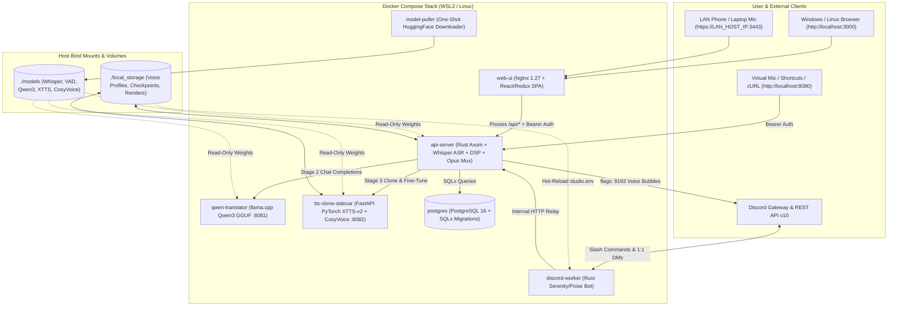
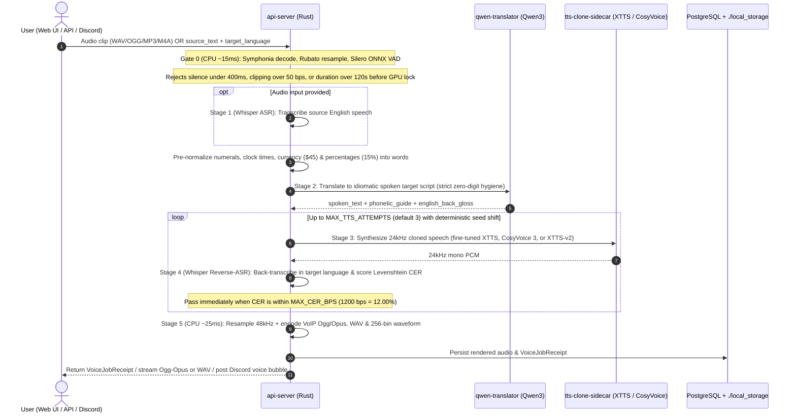
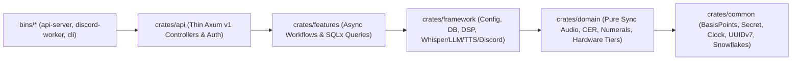

# Polyglot Voice Clone Pipeline & Studio (`voice-clone-pipeline`)

A **self-contained, 100% Docker-containerized** multilingual **zero-shot & fine-tuned voice cloning studio, REST API, and personal Discord voice agent** built on a **5-Crate Modular Rust Architecture** (`Rust 2024`, `Tokio`, `Axum`, `SQLx`, `Symphonia`, `Opus`, `whisper-rs`) paired with **`Qwen3`** (`llama.cpp`), **`CosyVoice 3.0`** + **`XTTS-v2`** (`FastAPI` / `PyTorch`), and a **React + Redux Toolkit Studio Web App**.

Run everything locally on your own GPU or CPU inside **WSL2 on Windows 10/11** (via Docker Desktop) or **Linux** — **zero cloud API keys, zero external CI/CD pipelines, and zero host Rust, Python, Node.js, or CUDA SDK installations required**.

---

## At a Glance

| Capability | What Is Included |
| :--- | :--- |
| **12 Target Languages** | Spanish (`es`), Mandarin Chinese (`zh`), French (`fr`), German (`de`), Italian (`it`), Portuguese (`pt`), Japanese (`ja`), Korean (`ko`), Russian (`ru`), Arabic (`ar`), Hindi (`hi`), and English (`en`) |
| **Voice Cloning & Fine-Tuning** | Enroll from a single **15-second `24 kHz` English clip**, stack **multi-sample reference clips**, tune temperature/repetition/speed sliders, or run **local GPU `XTTS-v2` GPT fine-tuning** |
| **Self-Healing Quality Gate** | **Gate-0 CPU DSP** blocks silence/clipping before GPU lock; **numeral/currency/time verbalization** prevents TTS digit glitches; **Whisper reverse-ASR** verifies Character Error Rate (`CER <= 12%`) across up to 3 seed-shifted retries |
| **Hardware Auto-Tiering** | `make setup` inspects VRAM & RAM and sizes models automatically across **Enthusiast (`>=16 GB`)**, **Mainstream (`8–15 GB`)**, **Entry (`4–7 GB`)**, and **CPU-Only** machines |
| **Interfaces Included** | **5-Tab React Studio Web UI** (`:3000` / `:3443`), **JSON & Binary Streaming REST API** (`:8080`), **Containerized CLI** (`enroll`, `doctor`, `bench`), and **Optional 1-on-1 Discord Bot & Slash Commands** (`/speak`, `/voice_clone`) |
| **Agent-First Operations** | Self-documenting [`Makefile`](Makefile), [`AGENT_INSTALL.md`](AGENT_INSTALL.md), `--non-interactive --json` setup/doctor scripts, and `GET /api/v1/agent/manifest` |

### Table of Contents
1. [System & Container Architecture](#1-system--container-architecture)
2. [How Voice Synthesis Works (6-Stage Pipeline)](#2-how-voice-synthesis-works-6-stage-pipeline)
3. [Repository Structure & 5-Crate Rust Design](#3-repository-structure--5-crate-rust-design)
4. [Installation & Setup (WSL2 on Windows & Linux)](#4-installation--setup-wsl2-on-windows--linux)
5. [Environment Configuration & Hardware Tiers (`.env`)](#5-environment-configuration--hardware-tiers-env)
6. [Studio Web UI, Fine-Tuning & REST API Reference](#6-studio-web-ui-fine-tuning--rest-api-reference)
7. [Discord Bot Pairing & Compliant Delivery Modes](#7-discord-bot-pairing--compliant-delivery-modes)
8. [Verification Gates & `Makefile` Reference](#8-verification-gates--makefile-reference)
9. [Architecture Docs & License](#9-architecture-docs--license)

---

## 1. System & Container Architecture

Everything runs inside an isolated Docker Compose stack ([`docker-compose.yml`](docker-compose.yml) + optional NVIDIA GPU overlay [`docker-compose.gpu.yml`](docker-compose.gpu.yml)):



### Runtime Services Summary
- **`model-puller`** (`python:3.12-slim`): Resumably downloads tier-matched weights (`Whisper`, `Silero VAD`, `Qwen3 GGUF`, `XTTS-v2`, and `CosyVoice 3.0`) into `./models` on first boot, skipping cached files on subsequent starts.
- **`postgres` & `db-migrate`** (`postgres:16-alpine` + `sqlx-cli`): Stores voice profiles, multi-sample metadata, fine-tuning job state, synthesis receipts, and benchmark scorecards.
- **`qwen-translator`** ([`sidecars/llama-cuda122/`](sidecars/llama-cuda122)): Compiles `llama-server` (`CUDA` SM `75;80;86;89` or pure `CPU`) to serve `Qwen3` structured JSON translations with `--reasoning-budget 0` for low latency.
- **`tts-clone-sidecar`** ([`sidecars/tts-worker/`](sidecars/tts-worker)): Python 3.11 + `FastAPI` + `PyTorch` (`cu121` or `cpu`) hosting `CosyVoice 3.0`, `XTTS-v2`, multi-reference conditioning, `1`-slot LRU fine-tuned checkpoint hot-swapping, speaker cosine similarity scoring, and background `XTTS-v2` GPT fine-tuning.
- **`api-server`** ([`bins/api-server/`](bins/api-server)): Rust orchestrator enforcing owner bearer auth, `Gate-0` DSP audio hygiene, single-permit GPU `Semaphore(1)` serialization, `whisper-rs` source/reverse ASR, and `48 kHz` Ogg/Opus + WAV encoding.
- **`web-ui`** ([`web/`](web)): Multi-stage Vite + React + TypeScript + Redux Toolkit app served by Nginx on `:3000` (HTTP) and `:3443` (auto-generated SAN TLS for LAN microphone capture), automatically injecting `OWNER_API_BEARER_TOKEN` on `/api/` requests.
- **`discord-worker`** ([`bins/discord-worker/`](bins/discord-worker)): Lightweight CPU worker handling `/speak`, `/voice_clone`, `/voice_settings`, `/voice_profiles`, `/mandarin_voice`, `@mention` prompts, and 1-on-1 DM voice notes. Stands by quietly when unconfigured and **hot-connects within 3 seconds** once credentials are saved in the Studio Web UI.

---

## 2. How Voice Synthesis Works (6-Stage Pipeline)

Every synthesis request — whether triggered from the Web Studio UI, `POST /api/v1/voice-jobs`, `POST /api/v1/voice-jobs/render`, or Discord `/speak` — flows through a deterministic verification pipeline:



### Automatic Engine Routing Across 12 Languages

| Profile / Target Language | Auto-Selected Engine | Supported Engines | Why |
| :--- | :--- | :--- | :--- |
| **Any Profile with an Active Fine-Tuned Checkpoint (`finetuned_checkpoint_dir`)** | **`xtts_v2` (Fine-Tuned GPT)** | `xtts_v2`, `cosyvoice_3` | Preserves your custom-trained speaker prosody & timbre across **all 12 languages** (including Mandarin `zh`) |
| **Mandarin (`zh`), Japanese (`ja`), Korean (`ko`)** *(zero-shot profile)* | **`cosyvoice_3`** | `cosyvoice_3`, `xtts_v2` | High tonal & CJK zero-shot fidelity (`falls back to xtts_v2` automatically on Entry/CPU tiers where CosyVoice is disabled) |
| **Spanish (`es`), French (`fr`), German (`de`), Italian (`it`), Portuguese (`pt`), Russian (`ru`), Arabic (`ar`), Hindi (`hi`), English (`en`)** | **`xtts_v2`** | `xtts_v2` (`+ cosyvoice_3` for `en`) | Strong multilingual prosody and multi-reference conditioning |

---

## 3. Repository Structure & 5-Crate Rust Design

The Rust backend enforces a strict **one-way dependency graph** (`bins/* -> api -> features -> framework -> domain -> common`), verified on every test run by [`crates/api/tests/architecture_boundaries.rs`](crates/api/tests/architecture_boundaries.rs) (zero `mod.rs` files, `<= 350` non-test LOC per crate source file, `< 100` LOC per binary `main.rs`, zero `.unwrap()`/`.expect()`/`panic!` in `src/`, and `std::env::vars()` restricted exclusively to `framework::config`):



### Annotated Directory Tree

```text
voice-clone-pipeline/
├── Makefile                        # Canonical WSL2 / Linux task runner (setup, up, doctor, verify, ...)
├── Justfile                        # Optional `just` aliases delegating to Makefile & Docker Compose
├── docker-compose.yml              # Base multi-container stack (runs out-of-the-box in CPU mode)
├── docker-compose.gpu.yml          # NVIDIA CUDA device reservation overlay (auto-selected when COMPUTE_MODE=gpu)
├── Dockerfile                      # Multi-stage Rust + CUDA 12.2 / CPU build (verify-runner, db-migrate, runtime)
├── .env.example                    # Fully documented environment template (tiers, GPUs, paths, ports, Discord)
├── AGENT_INSTALL.md                # Unattended AI-agent bootstrap, verification & customization contract
├── AGENTS.md                       # Engineering rules, crate invariants, and verification loop for coding agents
│
├── scripts/
│   ├── setup.sh                    # Probes WSL2/Linux GPUs, VRAM, RAM & LAN IP; creates dirs; writes .env safely
│   ├── doctor.sh                   # End-to-end readiness diagnostics (--json supported)
│   └── setup-discord.sh            # Interactive 5-stage wizard + non-interactive --json Discord bot setup
│
├── crates/
│   ├── common/                     # Tier 1: Pure sync primitives (BasisPoints, Secret<T>, Clock, sha256, Snowflakes)
│   ├── domain/                     # Tier 2: Pure sync business rules (Gate-0 DSP rules, 256-bin waveform, English
│   │                               #         numeral verbalizer, Levenshtein CER verifier, VRAM hardware tier planner)
│   ├── framework/                  # Tier 3: Concrete adapters (AppConfig, PgPool, Symphonia/Rubato/Opus/WAV, Silero
│   │                               #         ONNX VAD, whisper-rs, Qwen HTTP, TTS sidecar HTTP, Discord REST, Fakes)
│   ├── features/                   # Tier 4: Transport-agnostic workflows (voice_jobs, profiles, benchmarks, desktop)
│   └── api/                        # Tier 5: Thin 5–15 LOC Axum handlers, Owner Bearer guard, RFC 7807 Problem JSON
│
├── bins/
│   ├── api-server/                 # HTTP API & static SPA runtime entrypoint (<100 LOC main.rs)
│   ├── discord-worker/             # Serenity/Poise slash-command & 1:1 DM worker with studio.env hot-reload
│   └── cli/                        # Operational CLI (`enroll`, `doctor`, `bench`, `hardware-probe`)
│
├── sidecars/
│   ├── llama-cuda122/              # Builds llama.cpp `llama-server` (CUDA SM 75/80/86/89 or CPU) for Qwen3
│   └── tts-worker/                 # FastAPI + PyTorch worker (`cosyvoice_engine.py`, `xtts_engine.py`,
│                                   # `xtts_finetuner.py`, speaker similarity, and 51-test pytest suite)
├── web/                            # React 18 + TypeScript + Redux Toolkit Studio UI + Nginx TLS/Auth entrypoints
├── migrations/                     # SQLx PostgreSQL schema (profiles, multi-samples, tuning, finetune_jobs, jobs)
├── evals/golden_manifest.json      # 15-utterance English-to-Mandarin benchmark + 3 Gate-0 traps (M1–M6 thresholds)
└── docs/architecture/              # Deep-dive specs (00-blueprint, 01-crate-boundaries, 02-testing, 03-lints)
```

---

## 4. Installation & Setup (WSL2 on Windows & Linux)

### Prerequisites
1. **Windows 10/11 with WSL2 (`Ubuntu` / `Debian`)** — or a native **Linux** host.
   - **Important on WSL2:** Clone the repository inside your native Linux home directory (`~/voice-clone-pipeline`), **not** `/mnt/c/...`, so Docker bind-mounts and multi-GB model loads run at native NVMe speed instead of slow cross-OS 9P mounts.
2. **Docker Desktop for Windows** with **Settings -> Resources -> WSL Integration** enabled for your WSL2 distro (or `dockerd` + `docker compose` v2 on Linux).
3. **Optional — NVIDIA GPU (`>= 4 GB` VRAM):** Install a standard Windows NVIDIA Game Ready / Studio driver on Windows. WSL2 automatically exposes `/dev/dxg` and `/usr/lib/wsl/lib/nvidia-smi` inside Linux (do **not** install a Linux `.run` driver inside WSL2). Systems without an NVIDIA GPU automatically run in `COMPUTE_MODE=cpu`.
4. **WSL2 Memory Tip:** Windows defaults WSL2 VM memory to 50% of system RAM. On a 16 GB PC, adding `[wsl2]` + `memory=12GB` (or `16GB` on 32 GB+ PCs) to `%USERPROFILE%\.wslconfig` prevents memory pressure during initial compilation.

### Quickstart (3 Commands in WSL2 / Linux)

```bash
# 1. Clone onto the native WSL2 Linux filesystem
git clone https://github.com/cmkennedy20/voice-clone-pipeline.git ~/voice-clone-pipeline
cd ~/voice-clone-pipeline

# 2. Auto-detect GPU VRAM / CPU, create ./models & ./local_storage, and generate .env secrets
make setup

# 3. Compile containers locally, pull HuggingFace models, run SQLx migrations & boot stack
make up
```

Check health anytime with:
```bash
make doctor
```

Once `make doctor` reports `[OK]` for `API server ready` and `Windows Browser UI`:
- **On your Windows PC:** Open **`http://localhost:3000`** in Chrome or Edge. WSL2 forwards `localhost` automatically, and `localhost` is a W3C Secure Context so **live microphone recording works immediately** with zero certificate prompts.
- **From a phone or secondary laptop on Wi-Fi:** Open **`https://<LAN_HOST_IP>:3443`** and accept the auto-generated local SAN certificate once to enable LAN microphone capture.

### Agent-First Unattended Install (`Claude Code`, `Codex`, `Antigravity`, `Cursor`)
Point any coding agent at [`AGENT_INSTALL.md`](AGENT_INSTALL.md). Every setup, health, and pairing script supports non-interactive `--json` output:

```bash
make setup ARGS="--non-interactive --json"
make pull-models
make up
make doctor ARGS="--json"
```

---

## 5. Environment Configuration & Hardware Tiers (`.env`)

[`scripts/setup.sh`](scripts/setup.sh) probes `nvidia-smi` (including `/usr/lib/wsl/lib/nvidia-smi`), picks the **highest-VRAM GPU** on multi-GPU desktops, and writes matching settings into `.env` (preserving any secrets you already have). Full variable documentation lives in [`.env.example`](.env.example).

### Automatic Hardware Tier Presets

| Tier (`--tier`) | Target Hardware | `COMPUTE_MODE` | Whisper ASR Model | Qwen3 GGUF Model | `PULL_COSYVOICE` | Prewarmed TTS | Disk Space |
| :--- | :--- | :--- | :--- | :--- | :--- | :--- | :--- |
| **`enthusiast`** | NVIDIA `>= 16 GB` VRAM *(RTX 3090 / 4080 / 4090 / 5090)* | `gpu` | `ggml-large-v3.bin` | `Qwen3-8B-Q8_0.gguf` | `true` | `cosyvoice_3,xtts_v2` | `~18 GB` |
| **`mainstream`** | NVIDIA `8–15 GB` VRAM *(RTX 3060 12G / 3070 / 4060 / 4070)* | `gpu` | `ggml-medium.bin` | `Qwen3-8B-Q4_K_M.gguf` | `true` | `xtts_v2` | `~12 GB` |
| **`entry`** | NVIDIA `4–7 GB` VRAM *(RTX 2060 / 3050 / 6 GB Laptop)* | `gpu` | `ggml-small.bin` | `Qwen3-4B-Q4_K_M.gguf` (`-ngl 28`) | `false` | `xtts_v2` | `~5.5 GB` |
| **`cpu`** | No NVIDIA GPU *(AMD / Intel / CPU-only, `>= 16 GB` RAM)* | `cpu` | `ggml-small.bin` | `Qwen3-4B-Q4_K_M.gguf` (`-ngl 0`) | `false` | *(on-demand)* | `~5.5 GB` |

### Key `.env` Variables You Can Customize

| Variable | Default | Purpose |
| :--- | :--- | :--- |
| `COMPUTE_MODE` | `gpu` *(or `cpu`)* | Selects `-f docker-compose.gpu.yml` (`gpu`) vs pure CPU (`cpu`) |
| `NVIDIA_GPU_ID` | `0` *(or `GPU-...`)* | Pins a specific NVIDIA GPU index or UUID on multi-GPU desktops |
| `STUDIO_MODELS_DIR` | `./models` | Host path for downloaded HuggingFace weights (e.g. `/mnt/d/VoiceModels`) |
| `STUDIO_STORAGE_DIR` | `./local_storage` | Host path for enrolled WAVs, fine-tuned checkpoints, and rendered audio |
| `WEB_UI_PORT` / `WEB_UI_TLS_PORT` | `3000` / `3443` | Host HTTP & SAN HTTPS ports for the Studio Web App |
| `API_BIND_PORT` | `8080` | Host HTTP port for direct REST API & `/render` streaming |
| `LAN_HOST_IP` | Auto-detected | Windows/Linux LAN IPv4 baked into `:3443` self-signed SAN TLS cert |
| `OWNER_API_BEARER_TOKEN` | Random 32B hex | Guards `/api/v1/*` (injected server-side by `web-ui` Nginx proxy) |
| `DISCORD_APPLICATION_ID` / `DISCORD_BOT_TOKEN` / `DISCORD_OWNER_USER_ID` | Placeholders | Optional 1-on-1 Discord bot credentials (leave placeholders for Web-only mode) |
| `MAX_CER_BPS` / `MAX_TTS_ATTEMPTS` | `1200` / `3` | Max reverse-ASR Character Error Rate (`12.00%`) & seed-shift retry count |

*(After editing `.env`, apply changes anytime with `make restart`.)*

---

## 6. Studio Web UI, Fine-Tuning & REST API Reference

### Studio Web App (`http://localhost:3000`)
1. **Tab 1 — Multilingual Playground & API:** Pick any enrolled profile and target language (`12` languages), speak into your microphone or type plain English text, adjust optional per-job synthesis sliders (`temperature`, `length_penalty`, `repetition_penalty`, `top_k`, `top_p`, `speed`), play back the verified clone, and copy live `curl` snippets.
2. **Tab 2 — Voice Recording & Enrollment Studio:** Choose a guided 15-second reading script, record uncompressed `24 kHz` 16-bit mono WAV directly in the browser with live `Gate-0` level/clipping meters (or upload `.wav`/`.mp3`/`.m4a`/`.ogg`), queue multiple reference clips, and enroll a profile.
3. **Tab 3 — Profile Management & `XTTS-v2` GPT Fine-Tuning:** Add/remove reference audio clips on existing profiles, edit default tuning presets, or launch **local GPU `XTTS-v2` GPT fine-tuning** (`POST /api/v1/profiles/{slug}/finetune`) with live epoch/loss progress polling and 1-click toggle back to zero-shot base weights.
4. **Tab 4 — History, Runtime Config & Benchmarks:** Replay past synthesis jobs (`.ogg` or `.wav`), inspect CER basis points & latency, view hardware tier status, or trigger the 15-clip `M1–M6` evaluation suite.
5. **Tab 5 — Guide & Live Discord Pairing:** Pair your Discord bot directly from the browser (zero container rebuild!), launch OAuth2 install links, and copy Discord command examples.

### Core REST API Examples

#### 1) JSON Text-to-Cloned-Speech (`POST /api/v1/voice-jobs`)
```bash
curl -fsS -X POST "http://localhost:8080/api/v1/voice-jobs" \
  -H "Authorization: Bearer ${OWNER_API_BEARER_TOKEN}" \
  -H "Content-Type: application/json" \
  -d '{
    "profile_slug": "default_voice",
    "target_language": "es",
    "source_text": "Hey team, I will join the meeting in 5 minutes—the tickets cost $45.",
    "delivery": { "mode": "client_return_only" }
  }'
```
Returns `201 Created` (`VoiceJobReceipt`) with `spoken_text`, `phonetic_guide`, `english_back_gloss`, `back_transcribed_text`, `cer_bps`, `engine_used`, and `/api/v1/voice-jobs/{job_id}/audio?format=ogg|wav`.

#### 2) Direct Binary Audio Streaming (`POST /api/v1/voice-jobs/render`)
```bash
# English text -> Spanish 48kHz WAV (pipe directly into VB-Cable / BlackHole virtual mic)
curl -fsS -X POST "http://localhost:8080/api/v1/voice-jobs/render?profile=default_voice&lang=es&format=wav" \
  -H "Authorization: Bearer ${OWNER_API_BEARER_TOKEN}" \
  -F "source_text=See you at 3:30 PM tomorrow!" \
  -o spanish_48k.wav

# Recorded English audio -> Mandarin 48kHz VoIP Ogg/Opus
curl -fsS -X POST "http://localhost:8080/api/v1/voice-jobs/render?profile=default_voice&lang=zh&format=ogg" \
  -H "Authorization: Bearer ${OWNER_API_BEARER_TOKEN}" \
  -F "audio=@recording.wav" \
  -o mandarin_voice.ogg
```

#### Complete Endpoint Summary
- **Health & Discovery:** `GET /health/live` · `GET /health/ready` · `GET /api/v1/agent/manifest`
- **System & Onboarding:** `GET /api/v1/config` · `GET /api/v1/languages` · `GET /api/v1/system/status` · `POST /api/v1/system/discord-config`
- **Voice Profiles & Multi-Samples:** `GET /api/v1/profiles` · `POST /api/v1/profiles` · `PATCH /api/v1/profiles/{slug}` · `DELETE /api/v1/profiles/{slug}` · `GET /api/v1/profiles/{slug}/reference-audio` · `GET|POST /api/v1/profiles/{slug}/samples` · `GET /api/v1/profiles/{slug}/samples/{id}/audio` · `DELETE /api/v1/profiles/{slug}/samples/{id}`
- **GPU Fine-Tuning:** `POST /api/v1/profiles/{slug}/finetune` · `GET /api/v1/profiles/{slug}/finetune`
- **Synthesis & Benchmarks:** `POST /api/v1/voice-jobs` · `POST /api/v1/voice-jobs/render` · `GET /api/v1/voice-jobs` · `GET /api/v1/voice-jobs/{id}` · `GET /api/v1/voice-jobs/{id}/audio?format=ogg|wav` · `GET /api/v1/benchmarks` · `POST /api/v1/benchmarks/run`

---

## 7. Discord Bot Pairing & Compliant Delivery Modes

 Discord pairing is **100% optional** — the stack boots cleanly without Discord tokens. When you want to use your cloned voice on Discord:

- **Pair via Studio Web UI (Zero Restart):** Open `http://localhost:3000` -> **Tab 5 (`Pair Discord Bot`)**, paste your `Application ID`, `Bot Token`, and personal `Discord User ID`, and click **Save Discord Config & Start Bot**. `discord-worker` detects `/storage/studio.env` and connects within 3 seconds.
- **Or Pair via Interactive CLI Wizard:** Run `make setup-discord` (walks you through creating the Discord App, enabling `User Install` + `Guild Install`, verifying your Bot Token against Discord API v10, locking access strictly to your `DISCORD_OWNER_USER_ID`, and opening both OAuth2 install links).

### Discord Commands & 1-on-1 DM Relay
- **`/speak`** — Fast text-first command (`text` auto-focused, optional `language` & `profile`) that posts clean target-language script (e.g. pure Mandarin Hanzi) + playable cloned audio across any DM, Group DM, or server.
- **`/voice_clone`** — Full polyglot command (`12`-language dropdown, `audio` upload **or** `text` prompt, optional `voice_bubble`, `private_only`, and `spoiler_phonetics`).
- **`/voice_settings` & `/voice_profiles`** — Inspect enrolled profiles and set sticky default target language + profile for DMs.
- **Direct 1-on-1 Bot DM / `@mention` Chat** — Send `es: Joining in 5 minutes!`, plain text, or a recorded voice note directly to your bot to receive native Discord `IS_VOICE_MESSAGE` (`flags: 8192`) 256-bin waveform voice bubbles.

### Four Compliant Delivery Modes (Zero User-Token Automation)

| Mode | Appears From Personal Account? | Works in DMs, Group DMs & Servers? | Mechanism |
| :--- | :--- | :--- | :--- |
| **Mode A1: Virtual Mic (`VB-Cable` / `BlackHole`)** | **Yes (`100%` personal account, no `APP` tag)** | **Yes (live voice calls & Stages)** | Stream `/api/v1/voice-jobs/render?format=wav` (`48 kHz` WAV) into your virtual audio cable |
| **Mode A2: iOS Shortcut / Clipboard `.ogg`** | **Yes (`100%` personal account, no `APP` tag)** | **Yes (every DM & server)** | Fetch `/api/v1/voice-jobs/render?format=ogg` and Share/Paste (`Ctrl+V` / `Cmd+V`) |
| **Mode B: `USER_INSTALL` Personal App** | Shows `"<You> used /speak"` (`APP` badge) | **Yes (`integration_types: [1]`, `contexts: [0,1,2]`)** | Invokes `/speak` or `/voice_clone` anywhere on Discord without adding a bot to the server |
| **Mode C: 1-on-1 Bot DM / Webhook** | Bot DM or custom profile webhook | **1-on-1 Bot DM** & servers with bot/webhook | Returns native `flags: 8192` playable waveform bubbles or profile-avatar webhook messages |

---

## 8. Verification Gates & `Makefile` Reference

Every build, linter, database test, Python `pytest` suite, and React `Vitest` suite runs hermetically inside Docker — no host compilers required:

| Command | Description |
| :--- | :--- |
| `make help` | Show all targets and active `COMPUTE_MODE` (`gpu` or `cpu`) |
| `make setup` | Probe WSL2/Linux GPUs, VRAM, RAM & LAN IP, create `./models` + `./local_storage`, write `.env` |
| `make pull-models` | Resumably download tier-matched HuggingFace weights (`Whisper`, `VAD`, `Qwen3`, `XTTS`, `CosyVoice`) |
| `make build` | Compile all Rust, `llama.cpp`, Python TTS, and React Web UI Docker images locally |
| `make up` | Build images, pull models, run SQLx migrations, and start the full stack in background mode |
| `make doctor` | Run readiness checks on Docker, GPU visibility, `.env`, models, and `/health/ready` (`ARGS="--json"`) |
| `make setup-discord` | Run interactive 5-stage wizard (or `ARGS="--app-id ... --bot-token ... --owner-id ... --json"`) |
| `make enroll` | Enroll a WAV via CLI (`make enroll SLUG=my_voice WAV=clip.wav TRANSCRIPT="Hello..."`) |
| `make logs` | Tail container logs (`make logs SERVICE=api-server` to filter) |
| `make restart` / `make down` | Recreate services after `.env` edits / stop containers cleanly (preserving DB & models) |
| `make test-fast` | Fast pure Rust unit + `proptest` + hardware matrix + `architecture_boundaries` checks (`<3s` warm) |
| `make verify-sidecar` | Run the 51-test Python TTS sidecar `pytest` schema, tensor-shape & fine-tuner suite |
| `make verify-web` | Run React + Redux `tsc --noEmit`, 18-test `Vitest` integration suite, and `vite build` |
| `make lint` | Run `cargo fmt --check`, zero-warning `clippy -D warnings`, `verify-sidecar`, and `verify-web` |
| `make verify` | **Full CI/Agent Gate:** `fmt` + `clippy` + `165` `nextest` SQLx/Wiremock/API tests + `cargo deny` + sidecar + web |
| `make verify-gpu` | Live GPU CUDA readiness probe + 15-clip `M1–M6` benchmark scorecard (`evals/golden_manifest.json`) |

---

## 9. Architecture Docs & License

### Deep-Dive Documentation
- [`AGENT_INSTALL.md`](AGENT_INSTALL.md) — Unattended WSL2 / Docker bootstrap, hardware tier overrides, and `--json` agent contract
- [`AGENTS.md`](AGENTS.md) — Developer & AI-agent operational rules, crate dependency laws, and test loop
- [`docs/architecture/00-blueprint.md`](docs/architecture/00-blueprint.md) — End-to-end system specification, SQL schema, VRAM budget & `M1–M6` release gates
- [`docs/architecture/01-crate-boundaries.md`](docs/architecture/01-crate-boundaries.md) — 5-crate Rust responsibilities, vertical feature slices, and Discord compliance rules
- [`docs/architecture/02-testing-strategy.md`](docs/architecture/02-testing-strategy.md) — 7-layer deterministic test pyramid (unit, property, DSP round-trips, Wiremock, SQLx, Axum `oneshot`, live GPU)
- [`docs/architecture/03-verification-and-lints.md`](docs/architecture/03-verification-and-lints.md) — Clippy, `cargo-deny`, file-size budgets, and CUDA stub-vs-runtime linking notes

### License & Third-Party Model Weights
- **Repository Source Code:** Dual-licensed under either **MIT** ([`LICENSE-MIT`](LICENSE-MIT)) or **Apache-2.0** ([`LICENSE-APACHE`](LICENSE-APACHE)), at your option.
- **Runtime-Downloaded Model Weights:** No model weights or voice recordings are stored or distributed in this repository. Weights downloaded onto your machine by `make pull-models` / `make up` are governed by their upstream licenses:
  - `ggerganov/whisper.cpp` & `onnx-community/silero-vad`: MIT
  - `Qwen/Qwen3-*-GGUF` & `FunAudioLLM/CosyVoice2-0.5B`: Apache-2.0
  - `coqui/XTTS-v2`: [Coqui Public Model License (`CPML`)](https://coqui.ai/cpml) (non-commercial use unless separately licensed)
